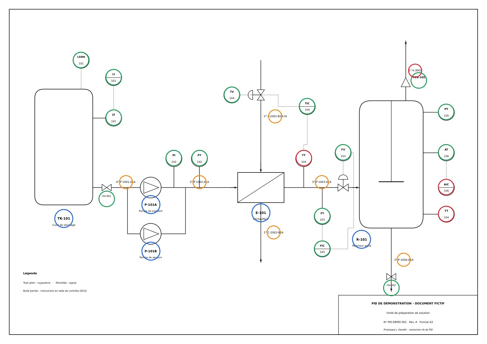

# Extraction automatique d'informations à partir de PID (P&ID)

Prototype qui transforme un **PID au format PDF** en **listes exploitables** (équipements, instruments,
lignes, boucles de régulation) et qui **contrôle automatiquement sa cohérence**.

Sur un projet d'ingénierie, ces listes sont aujourd'hui recopiées à la main depuis les PID, puis
mises à jour à chaque révision. L'objectif est de faire gagner ce temps aux équipes et de repérer
les erreurs plus tôt, avant les études de détail et la HAZOP.



## Ce que fait le prototype

| Étape | Ce qui se passe |
|---|---|
| 1. Lecture | Chaque texte du PDF est lu avec sa position sur le plan (PyMuPDF). |
| 2. Bulles ISA | Les repères d'instruments écrits sur deux lignes dans les bulles (« FIC » au-dessus de « 103 ») sont réassemblés en « FIC-103 ». |
| 3. Classification | Chaque repère est reconnu et décodé selon la norme ISA 5.1 : équipement, instrument (type, grandeur mesurée) ou numéro de ligne (diamètre, fluide, classe de tuyauterie, isolation). |
| 4. Boucles | Les instruments sont regroupés par boucle (FT-103 + FIC-103 + FV-103 = boucle de régulation de débit 103). |
| 5. Contrôles | Repères en double, régulateur sans vanne, vanne sans régulateur, régulateur sans mesure, ligne sans classe de tuyauterie, plan scanné. |
| 6. Export | Listes au format Excel (un onglet par liste), prêtes à être reprises par les équipes. |
| 7. Mesure | Comparaison avec un relevé fait à la main : rappel et précision par catégorie. |

Deux méthodes d'extraction :
- **Règles ISA (par défaut)** : 100 % locale, sans IA générative, reproductible. Fonctionne sur les PDF
  vectoriels (exportés depuis AutoCAD Plant 3D, AVEVA, Smart P&ID…).
- **IA vision (optionnelle)** : un LLM multimodal (GPT-4o via Azure OpenAI) lit l'image du plan.
  Utile pour les PID scannés et pour détecter les connexions entre équipements.

## Résultat sur le PID de démonstration

Le dossier `samples/` contient un PID **fictif** (unité de préparation : cuve, pompes, réchauffeur, réacteur)
dans lequel trois erreurs ont été glissées volontairement.

| Catégorie | Attendus | Trouvés | Rappel |
|---|---|---|---|
| Équipements | 5 | 5 | 100 % |
| Instruments | 17 | 17 | 100 % |
| Lignes | 7 | 7 | 100 % |
| Anomalies | 3 | 3 | 100 % |

Les trois anomalies détectées : repère `TT-104` en double, régulateur `AIC-106` sans vanne,
ligne `1"-V-3001` sans classe de tuyauterie. Analyse en moins d'une seconde.

**Limite assumée** : ce PID est un PDF vectoriel propre. Sur de vrais PID (symboles propres à chaque client,
plans scannés, plans très denses), les résultats seront plus faibles. La prochaine étape est de mesurer
la précision sur un échantillon de PID réels, puis d'ajouter la détection des symboles par vision
par ordinateur (YOLO) et la reconstruction des connexions.

## Installation et lancement (Windows)

Prérequis : [Python 3.10 ou plus](https://www.python.org/downloads/) (cocher « Add Python to PATH » à l'installation).

```powershell
cd pid-extractor
python -m venv .venv
.venv\Scripts\activate
pip install -r requirements.txt

python generate_sample_pid.py      # crée le PID de démonstration
streamlit run app.py               # ouvre l'interface dans le navigateur
```

Sur Mac / Linux : `source .venv/bin/activate` à la place de `.venv\Scripts\activate`.

En ligne de commande :

```powershell
python cli.py samples\pid_demo.pdf --excel listes.xlsx
```

Tests :

```powershell
pytest
```

### Mode IA vision (optionnel)

```powershell
pip install openai
# Azure OpenAI (recommandé en entreprise : les données restent dans l'environnement de la société)
$env:AZURE_OPENAI_ENDPOINT="https://<ressource>.openai.azure.com"
$env:AZURE_OPENAI_API_KEY="<clé>"
$env:AZURE_OPENAI_DEPLOYMENT="gpt-4o"
streamlit run app.py
```

Ne jamais envoyer de PID client vers un service public : ces documents sont confidentiels.

## Structure du projet

```
pid-extractor/
├── app.py                    interface Streamlit
├── cli.py                    utilisation en ligne de commande
├── generate_sample_pid.py    génère le PID fictif de démonstration
├── pid_extractor/
│   ├── isa.py                règles ISA 5.1 : décodage des repères
│   ├── extract.py            lecture du PDF, bulles ISA, classification
│   ├── analysis.py           boucles, contrôles de cohérence, mesure de précision
│   ├── export.py             export Excel
│   └── llm_vision.py         mode IA vision (Azure OpenAI / OpenAI)
├── samples/                  PID de démonstration + relevé manuel (vérité terrain)
└── tests/                    tests automatisés
```

## Pistes d'évolution

1. Mesurer la précision sur des PID réels et adapter les règles aux conventions de chaque client.
2. Détecter les symboles (vannes, pompes, instruments) par vision par ordinateur (YOLO) pour les plans scannés.
3. Reconstruire le graphe des connexions (qui est relié à quoi) et l'exporter au format standard DEXPI.
4. Comparer automatiquement deux révisions d'un PID et lister les impacts sur les livrables.
5. Assistant de questions sur les PID d'un projet (RAG) : « quels instruments sur la ligne 1003 ? ».
6. Retrouver les projets passés similaires pour réutiliser études et chiffrages.

---

Réalisé par **Jeffrey Gandhi** — [LinkedIn](https://www.linkedin.com/in/jeffrey-gandhi-48693a378)
